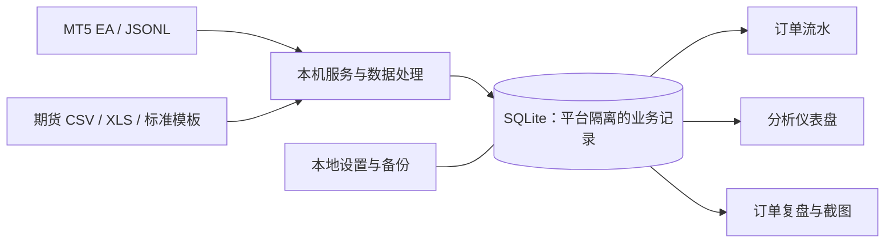
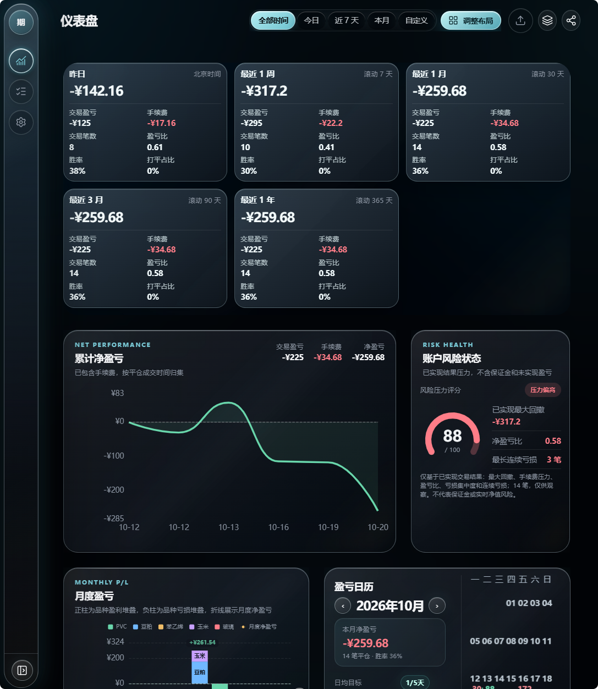
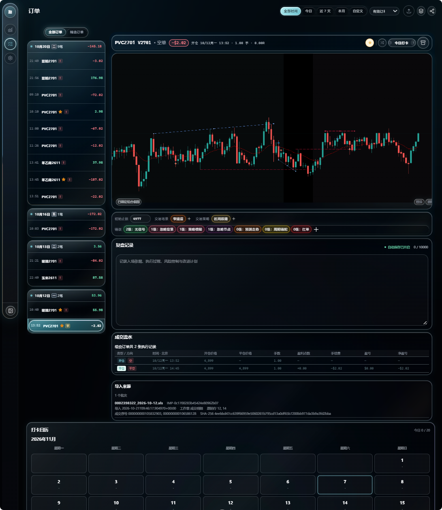
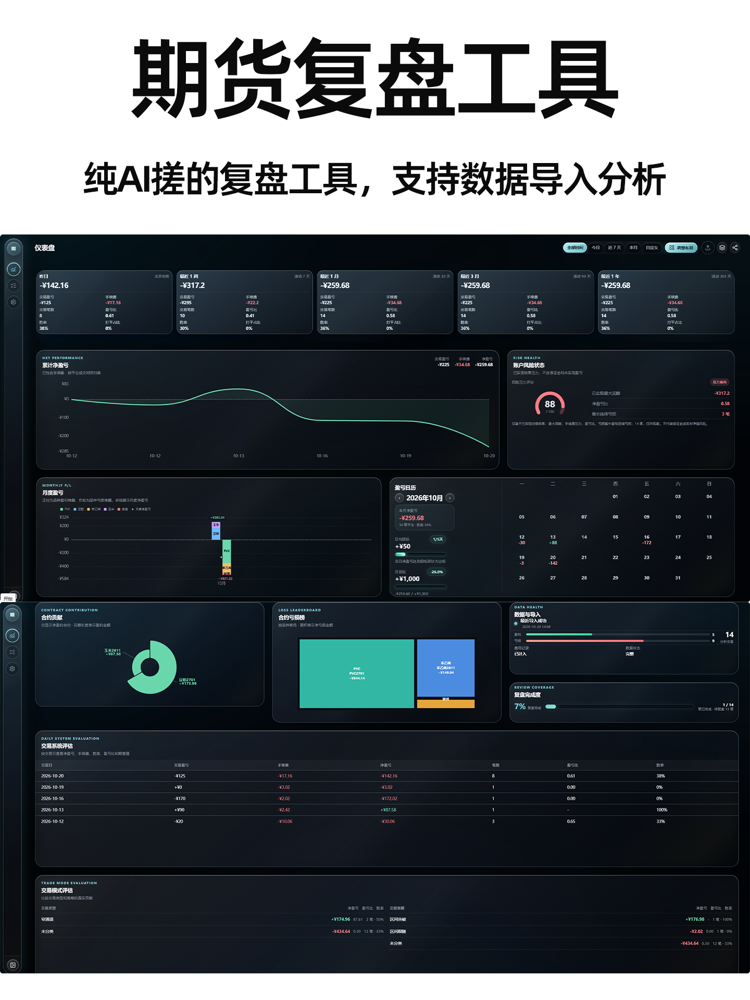
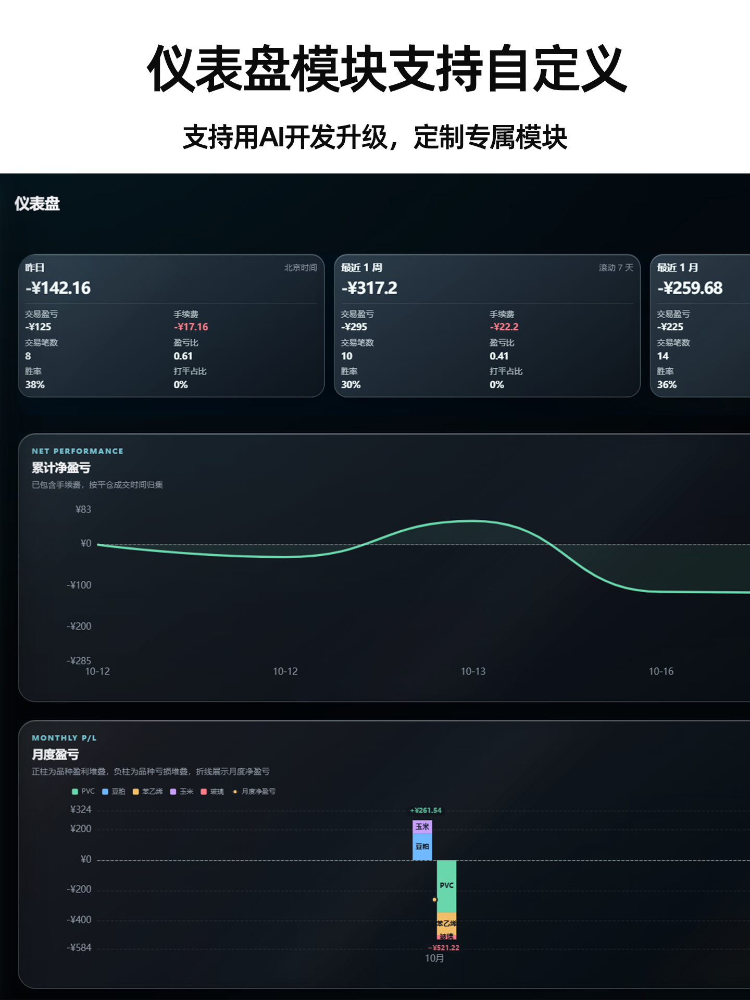
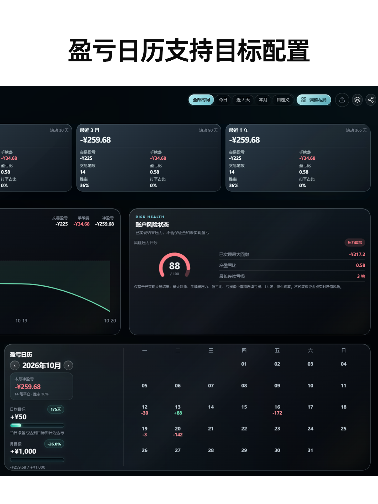
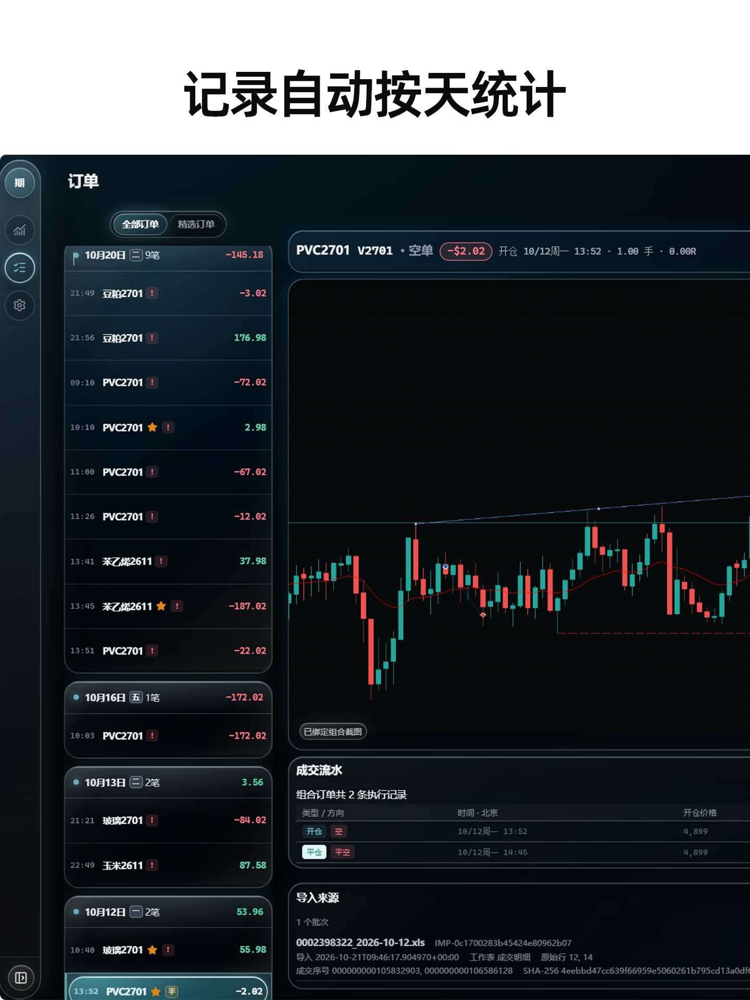
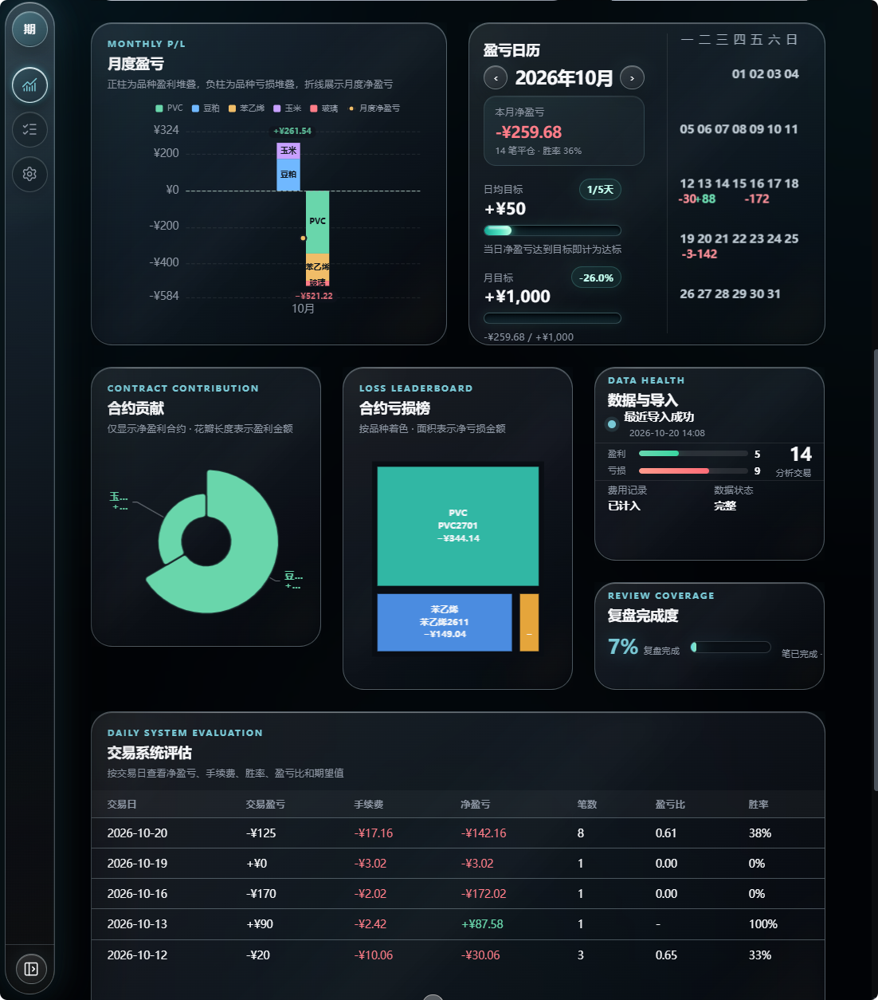

# MT5 复盘仪表盘

一个运行在个人电脑上的交易复盘工具，支持 **MetaTrader 5** 和 **国内期货成交记录**。它把成交、交易组合、复盘笔记、截图和统计放进同一个本地工作区，帮助交易者按订单回看执行过程并分析结果。

**当前版本：`v1.2.1`**（以根目录 `VERSION` 为准） · [版本发布](https://github.com/zfun3018/mt5-review-dashboard/releases) · [许可证：MIT](LICENSE)

> 本项目采用 local-first 设计：业务数据存储在本机 SQLite，网页由本机服务提供。项目代码可以公开分享，真实交易数据、账户信息、截图和本机配置应留在本机。

## 项目一览

| | |
| --- | --- |
| 支持平台 | MetaTrader 5、国内期货成交导入 |
| 运行方式 | Windows 本机服务 + 浏览器 |
| 服务端 | Python 3.11+ 标准库 HTTP 服务、SQLite |
| 前端 | 原生 HTML、CSS、JavaScript；无需构建 |
| Python 依赖 | 无第三方运行时依赖 |
| 默认地址 | `http://127.0.0.1:9277` |
| 适合人群 | 希望在本机整理交易数据、持续做订单复盘和统计的人 |

### 从数据到复盘



## 主要功能

- **订单与交易组合**：以 Campaign 作为订单复盘和分析单位，可展开 Position 与 Deal，查看加仓、部分平仓和成交明细；MT5 支持初始止损及 R 倍数相关分析。
- **仪表盘**：查看周期指标、累计收益、月度盈亏、盈亏日历、交易时段分布、系统评估和交易模式；国内期货工作区提供独立的日均目标和月目标进度。
- **订单复盘**：查看组合截图和成交过程，记录复盘文字、交易场景、策略、犯错标签及自定义字段；支持精选、随机回看、每日打卡、归档与恢复。
- **双平台工作区**：MT5 与国内期货数据按平台隔离；订单、仪表盘和复盘页读取同一套持久化业务记录。
- **导入审计**：国内期货导入保留来源文件、批次、工作表、行号和成交序号，可查看重复、无效、冲突和未配对原因，并撤销导入批次。
- **本地维护**：设置页提供数据状态、配置、备份和按账户/日期范围预览后清理数据的入口。

## 界面预览

仪表盘汇总交易表现、风险状态、月度盈亏与交易日历：



订单复盘页面将成交列表、图表、标签、笔记和打卡记录放在一起：



<details>
<summary>查看其他项目界面图</summary>











</details>

## 安装与启动

### 环境要求

- Windows 10/11；
- Python 3.11 或更高版本；
- PowerShell 5.1 或更高版本；
- 仅 MT5 实时同步需要 MetaTrader 5 和 MetaEditor；Node.js 仅用于开发测试。

### 首次运行

1. 从 [GitHub Releases](https://github.com/zfun3018/mt5-review-dashboard/releases) 下载并解压项目，或克隆仓库。
2. 在项目根目录创建本机配置文件：

   ```powershell
   Copy-Item .\mt5-review-system\config.local.example.json .\mt5-review-system\config.local.json
   ```

3. 双击 `一键启动MT5复盘仪表盘.bat`，或在 PowerShell 中运行：

   ```powershell
   Set-Location .\mt5-review-system
   .\start.ps1
   ```

4. 浏览器打开 `http://127.0.0.1:9277`。

不需要 `pip install`。首次启动会在运行数据目录初始化 SQLite。升级前先备份本地数据；不要用 GitHub 上的代码包覆盖或分享个人数据目录。

## 连接 MetaTrader 5

MT5 EA 通过本机 HTTP WebRequest 将交易事件推送给仪表盘服务，同时把事件写入本地 JSONL 文件，供断线或漏传时增量回灌。

1. 启动仪表盘服务，并确认浏览器能打开 `http://127.0.0.1:9277`。
2. 复制并填写 `mt5-review-system/config.local.json` 中的 MT5 安装目录、终端数据目录、EA 安装目录和桥接目录。该文件只保存在本机。
3. 在 `mt5-review-system` 目录运行 `.\tools\install_ea.ps1`，然后用 MetaEditor 编译 `mt5-ea/MT5ReviewBridge.mq5`。
4. 在 MT5 的 **工具 → 选项 → EA 交易** 中允许 WebRequest 地址 `http://127.0.0.1:9277`；将 Bridge EA 挂载到一个持续运行的图表。
5. 回到仪表盘查看订单。若 WebRequest 期间有事件未同步，在 `mt5-review-system` 运行 `.\tools\import_from_mt5.ps1`，从桥接目录回灌 `events_*.jsonl`。

详细路径配置、EA 行为、行情导出和故障说明见[运行与开发说明](mt5-review-system/README.md)。若服务与 MT5 不在同一台电脑，只能使用可信局域网地址，并相应配置 MT5 WebRequest 白名单；服务没有登录认证，不要暴露到公网。

## 导入国内期货成交

切换到页面右上角的 **国内期货** 工作区，进入 **设置 → 数据导入**。目前支持两种来源：仪表盘提供的标准 CSV 模板，以及中国期货市场监控中心导出的成交数据。监控中心文件可直接导入，无需先转换成标准模板；首次使用建议先导入少量记录，检查订单、交易日、手续费与盈亏，再导入完整历史。

### 中国期货市场监控中心数据

在监控中心导出成交明细后，切换到国内期货工作区，在 **设置 → 数据导入** 选择导出的 CSV 或 XLS 文件并查看导入报告。原始文件会在本机解析，系统会识别成交记录、标准化字段、按成交序号去重，并按 FIFO 规则匹配开仓和平仓成交；异常、重复和未配对记录会列入批次报告。建议保留原始导出文件作为本地对照，先核对导入结果，再批量导入历史数据。

如果选择使用标准 CSV 模板，请从导入页面下载最新模板。模板字段如下：

| 模板字段 | 从导出文件映射的内容 |
| --- | --- |
| `trade_date`、`trade_time` | 成交日期和时间，按模板分列填写 |
| `symbol` | 成交合约代码 |
| `side` | 成交方向：`buy` 或 `sell` |
| `offset` | `open` 或 `close`；来源拆分平今/平昨时都映射为 `close` |
| `quantity`、`price` | 实际成交数量和价格 |
| `fee` | 成交对应手续费；来源提供时填写 |
| `pnl` | 平仓成交盈亏；来源提供时填写。若来源没有平仓盈亏，系统无法还原真实结果 |
| `trade_id` | 来源成交编号，建议保留以便稳定去重和追溯 |
| `order_id` | 来源委托编号；有该字段时可填写 |

导入页会校验记录、去重并按 FIFO 规则尝试匹配开平成交；未匹配数据可在设置页查看并按剩余手数手动配对。交易日排序会处理夜盘归属，来源行和批次审计信息可用于定位问题。首次导入请核对导入报告、订单详情和仪表盘统计，再导入完整历史。K 线截图需自行截取后在订单详情上传，系统不会自动截取交易软件画面。

导入前请确认成交日期、开平标志、费用和盈亏的含义与导出报告一致。若导入报告提示异常或未配对，可按批次查看文件来源、行号和具体原因；不要通过猜测字段口径来修正数据。不要把账户号、客户号或真实成交文件发给 AI 或公开到 issue。

### 导入后的统计口径

- 订单列表和复盘画册按开仓交易日归组；
- 已实现盈亏和盈亏日历按平仓成交时间统计；
- 原始导入文件只在本机处理，批次记录用于审计和撤销；
- 未提供的平仓盈亏不会凭空计算，遇到缺失值需在导入前确认数据源能否补足。

## 页面导航

| 页面 | 用途 |
| --- | --- |
| `/dashboard/` | 周期指标、收益曲线、日历、热力图及评估 |
| `/orders/` | Campaign/Position/Deal 订单流水、复盘字段和截图 |
| `/settings/` | 数据导入、分类、自定义字段、分析设置和本地维护 |
| 订单复盘 | 在订单页面按组合回看截图、精选内容、打卡和成交流水 |

项目内所有页面从同一数据库读取业务记录。复盘标签、策略、笔记等归属于交易组合；其它页面通过持久化关系读取，不单独复制一份数据。

## 使用 AI 协助部署

可以让本机 AI 编程助手检查部署步骤或协助排查代码。建议在项目目录打开 AI 工具，并使用下面的提示词：

```text
请先阅读 README.md、AGENTS.md、docs/AI-DEPLOYMENT-GUIDE.md 和相关测试。
帮我按现有项目方式在本机部署 MT5 复盘仪表盘：先检查 Python/PowerShell 环境和启动脚本，
再说明我需要手动填写哪些本机配置、如何编译 EA、如何验证服务与 MT5 的本地连接。
遵守仓库隐私边界：不要读取、打印、上传或提交 data、backups、config.local.json、真实截图、
原始 JSONL、账户号、订单号、终端 ID 或本机隐私路径；不要开放公网端口；不要改动业务代码，
除非我另行要求。任何测试或修改前，先报告检查结果和准备执行的具体命令。
```

AI 只应处理源代码、脱敏配置模板和合成测试数据。本机配置值、真实成交文件和账户相关信息不要粘贴到对话里。完整的验证、备份恢复、回滚与发布流程见[AI 部署指南](docs/AI-DEPLOYMENT-GUIDE.md)。

## 项目联系

如需交流项目使用或反馈问题，可扫码添加微信：

<p align="center"></p>

## 隐私与网络安全

- 服务默认监听 `127.0.0.1`，没有登录认证，只适用于本机或可信局域网；不要配置公网端口转发。
- `mt5-review-system/data/`、`mt5-review-system/backups/` 和 `mt5-review-system/config.local.json` 是本机运行数据，不得提交或分享。
- 账户号、订单号、终端 ID、本机路径、真实截图和 MT5 原始 JSONL 都属于私有信息。
- 手机访问只应在可信 Wi-Fi 中临时开启局域网监听，并在使用结束后恢复本机监听。
- Windows 防火墙或杀毒软件提示时，检查程序路径和端口用途；只允许可信专用网络访问。

## 项目文档

- [项目技术说明](docs/PROJECT-GUIDE.md)：系统结构、数据流、数据归属与隐私规则；
- [AI 部署指南](docs/AI-DEPLOYMENT-GUIDE.md)：AI 协作、部署检查、备份恢复与回滚；
- [运行与开发说明](mt5-review-system/README.md)：MT5 EA、JSONL 回灌、期货导入、接口和测试；
- [版本路线](docs/VERSION-ROUTE.md) 与 [变更记录](CHANGELOG.md)；
- [发布指南](docs/RELEASE-GUIDE.md)、[贡献规范](CONTRIBUTING.md)、[安全策略](SECURITY.md) 和 [AI 协作规则](AGENTS.md)；
- [架构决策](docs/adr/)、[设计档案](docs/superpowers/specs/) 与 [实施档案](docs/superpowers/plans/)。

## 开发验证

后端测试（从 `mt5-review-system/server` 运行）：

```powershell
python -m unittest discover -s tests -p "test_*.py"
```

前端静态检查（从 `mt5-review-system` 运行）：

```powershell
node --test web/tests/custom-fields-ui.test.js web/tests/review-album-ui.test.js
node --check web/shared/js/shell.mjs
node --check web/dashboard/dashboard.mjs
node --check web/orders/orders.mjs
node --check web/album/album.mjs
node --check web/settings/settings.mjs
```

完整发布检查：`python .\tools\check_release.py`。发布前还应完成桌面与 390px 移动端检查，并按[发布指南](docs/RELEASE-GUIDE.md)同步版本和变更记录。
